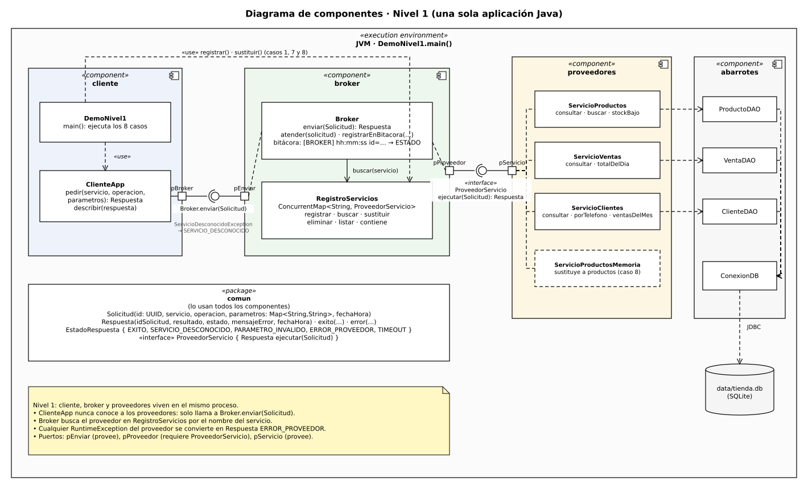
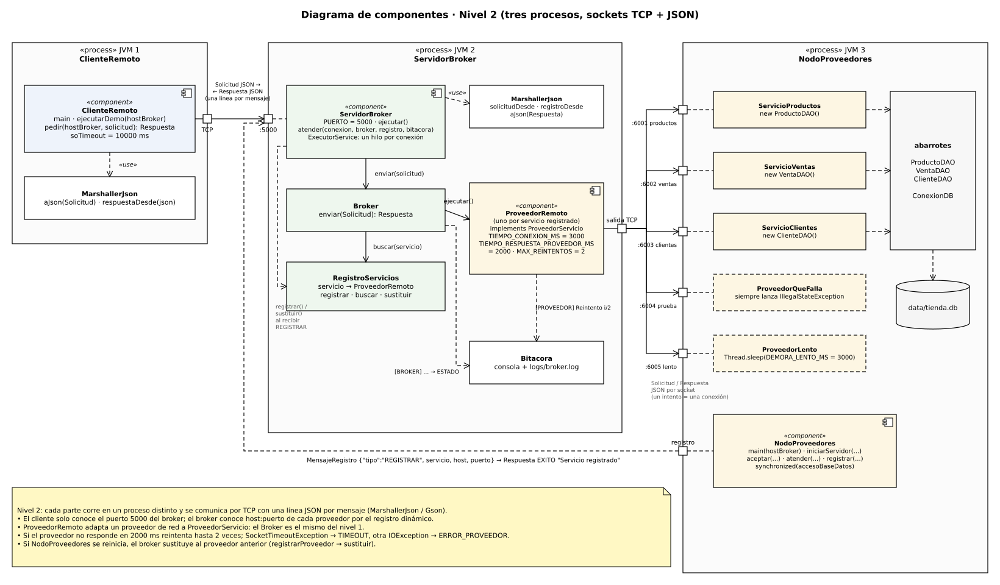
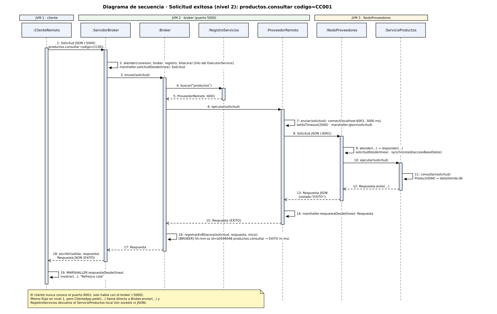
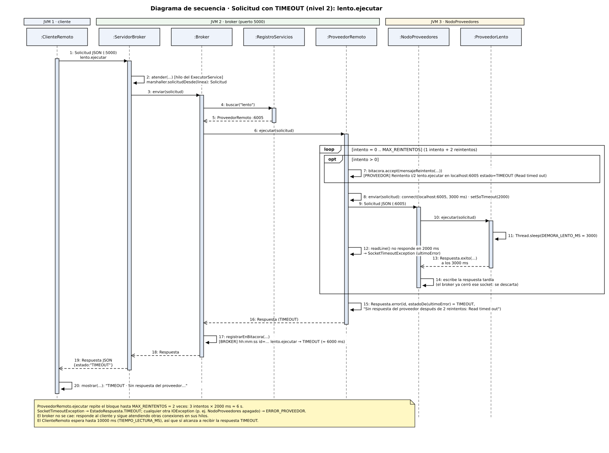
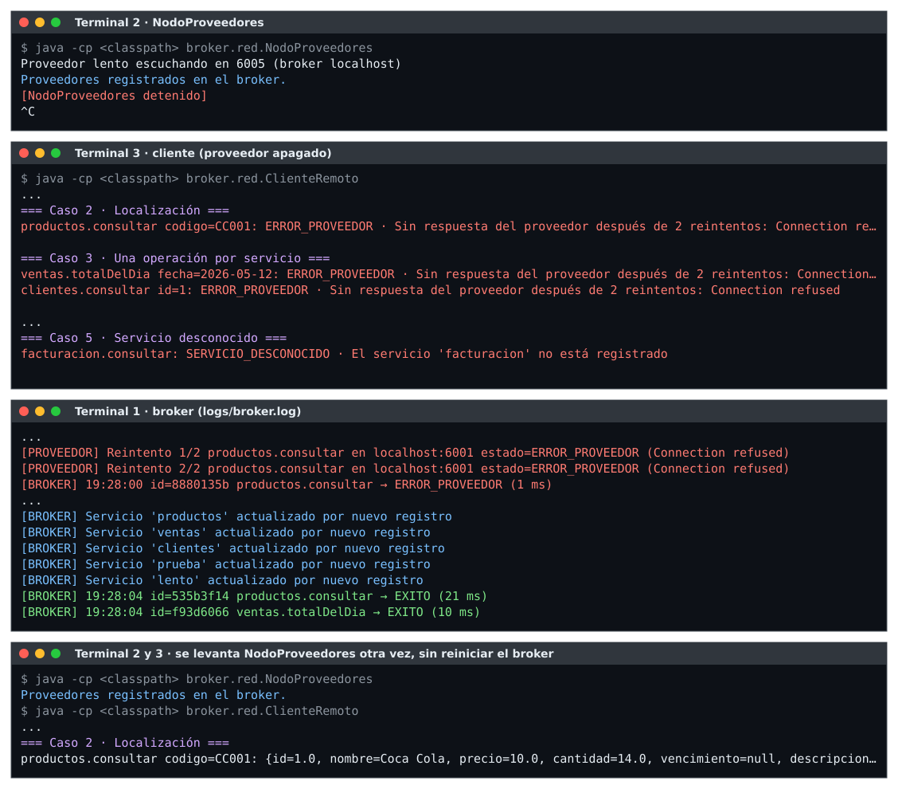
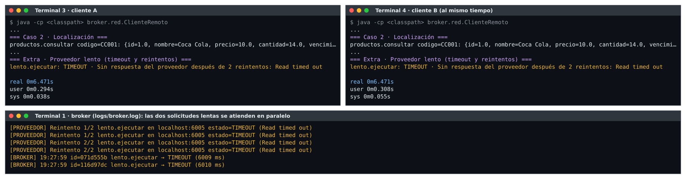

# Prototipo del patrón Broker sobre el Sistema de Gestión de Abarrotes

**Tarea 05 · Arquitectura de Software** · Licenciatura en Ingeniería de Software, FMAT-UADY
**Equipo:** Diego Cerón, Luis Villanueva, Oswaldo Castillo, Adriel Gong, Paola Parra
**Repositorio:** https://github.com/Luis-villanueva-valdivia/BrokerAbarrotes · **Fecha:** 14 de noviembre de 2026

---

## 1. Sistema elegido

Partimos del **Sistema de Gestión de Abarrotes** de Diego Cerón y su equipo (Java + SQLite), en su versión
[`v1.0-original`](https://github.com/Luis-villanueva-valdivia/SistemaGestionAbarrotes/releases/tag/v1.0-original),
antes de la refactorización que se hace en Construcción de Software. El sistema administra productos, ventas y
clientes de una tienda. De él copiamos sin cambios los modelos y DAO al paquete `broker.abarrotes`
(`ProductoDAO`, `VentaDAO`, `ClienteDAO`, `ConexionDB` y sus `*Model`), junto con la base `data/tienda.db`.

Elegimos este sistema porque ya tiene tres áreas de negocio bien separadas (productos, ventas y clientes) que se
convierten de forma natural en tres **servicios** independientes, y porque sus DAO pueden reutilizarse sin tocar la
lógica original.

## 2. Arquitectura

El prototipo aplica el patrón **Broker**: el cliente pide un servicio por su nombre, sin conocer la clase ni la
máquina que lo atiende. El broker busca en un registro quién resuelve ese servicio, le reenvía la solicitud y
devuelve la respuesta. Se construyó en dos niveles:

| Nivel | Despliegue | Comunicación |
|---|---|---|
| **1** | Cliente, broker y proveedores en la misma JVM (`DemoNivel1`). | Llamadas a métodos: `Broker.enviar(Solicitud)` → `ProveedorServicio.ejecutar(Solicitud)`. |
| **2** | Tres procesos: `ClienteRemoto`, `ServidorBroker` (puerto 5000) y `NodoProveedores` (puertos 6001–6005). | Sockets TCP con un mensaje JSON por línea (`MarshallerJson`). |

El punto clave es que **el `Broker` es la misma clase en los dos niveles**. En el nivel 2 solo cambia lo que hay en el
registro: en vez de un `ServicioProductos` local, el registro guarda un `ProveedorRemoto`, que implementa la misma
interfaz `ProveedorServicio` pero reenvía la solicitud por red (patrón *proxy* del lado del broker).





## 3. Componentes

| Paquete | Clases | Responsabilidad |
|---|---|---|
| `broker.comun` | `Solicitud`, `Respuesta`, `EstadoRespuesta`, `ProveedorServicio` | Contrato común. `EstadoRespuesta` tiene `EXITO`, `SERVICIO_DESCONOCIDO`, `PARAMETRO_INVALIDO`, `ERROR_PROVEEDOR` y `TIMEOUT`. |
| `broker.broker` | `Broker`, `RegistroServicios`, `ServicioDesconocidoException` | `RegistroServicios` mapea nombre de servicio → proveedor (`ConcurrentHashMap`) con `registrar`, `buscar`, `sustituir` y `eliminar`. `Broker.enviar` busca, reenvía, convierte cualquier excepción en una `Respuesta` de error y escribe la bitácora. |
| `broker.proveedores` | `ServicioProductos`, `ServicioVentas`, `ServicioClientes`, `ServicioProductosMemoria` | Adaptan los DAO al contrato `ProveedorServicio`. Operaciones: `productos` (`consultar`, `buscar`, `stockBajo`), `ventas` (`consultar`, `totalDelDia`), `clientes` (`consultar`, `porTelefono`, `ventasDelMes`). `ServicioProductosMemoria` sustituye a productos en el caso 8. |
| `broker.cliente` | `ClienteApp`, `DemoNivel1` | Cliente del nivel 1 y las 8 pruebas obligatorias. |
| `broker.red` | `ServidorBroker`, `NodoProveedores`, `ProveedorRemoto`, `ClienteRemoto`, `MarshallerJson`, `MensajeRegistro` | Nivel 2: servidor TCP con un hilo por conexión, nodo con los proveedores, *proxy* remoto con timeouts y reintentos, cliente de red y conversión a JSON. |
| `broker.abarrotes` | DAO y modelos del sistema original | Acceso a `data/tienda.db`. |

**Tiempos del nivel 2** (constantes en el código): conexión al proveedor 3000 ms (`ServidorBroker.TIEMPO_CONEXION_MS`),
espera de respuesta 2000 ms (`TIEMPO_RESPUESTA_PROVEEDOR_MS`), hasta 2 reintentos (`ProveedorRemoto.MAX_REINTENTOS`).
`NodoProveedores` agrega dos servicios de prueba: `prueba` (puerto 6004, siempre lanza una excepción) y `lento`
(puerto 6005, tarda 3000 ms) para provocar el `TIMEOUT`.

## 4. Protocolo JSON

Todo mensaje es un objeto JSON en **una sola línea**, para leerlo con `readLine()`. La especificación completa está
en [`docs/protocolo.md`](protocolo.md). Hay tres mensajes:

```json
{"id":"e0599048-…","servicio":"productos","operacion":"consultar","parametros":{"codigo":"CC001"},"fechaHora":"2026-11-14T01:12:42.354"}
{"idSolicitud":"e0599048-…","resultado":{"nombre":"Coca Cola", "…":"…"},"estado":"EXITO","mensajeError":null,"fechaHora":"2026-11-14T01:12:42.400"}
{"tipo":"REGISTRAR","servicio":"productos","host":"localhost","puerto":6001}
```

`ServidorBroker.atender` distingue un registro de una solicitud por la presencia del campo `tipo`. Un JSON vacío,
mal formado o con valores fuera de rango hace que `MarshallerJson` lance `IllegalArgumentException`, y el servidor la
responde como `PARAMETRO_INVALIDO` sin caerse.



## 5. Evidencias

Las 8 pruebas del nivel 1 están en `DemoNivel1` (ISS-07). Para el nivel 2 corrimos los tres procesos y los cuatro
escenarios que pide el ISS-13. Las capturas, la salida completa de cada consola y el `logs/broker.log` de la corrida
están en [`docs/evidencias/nivel2/`](evidencias/nivel2/).

| Escenario | Resultado observado | Captura |
|---|---|---|
| **Timeout** | `lento.ejecutar` responde `TIMEOUT` a los 6017 ms: 3 intentos de 2000 ms. | `01-timeout.svg` |
| **Reintento** | La bitácora registra `Reintento 1/2` y `2/2` con su causa (`Read timed out` o `Connection refused`). | `02-reintentos.svg` |
| **Proveedor apagado** | Con `NodoProveedores` detenido, cada servicio responde `ERROR_PROVEEDOR` después de 2 reintentos y el broker sigue atendiendo; `facturacion` sigue respondiendo `SERVICIO_DESCONOCIDO`. Al levantar el nodo otra vez, el broker escribe `actualizado por nuevo registro` y todo vuelve a responder `EXITO` sin reiniciarlo. | `03-proveedor-apagado.svg` |
| **Dos clientes a la vez** | Dos `ClienteRemoto` simultáneos terminan la demo completa (10 solicitudes) en 6.47 s cada uno, no en 12 s: las dos solicitudes lentas se atendieron en paralelo en hilos distintos. | `04-dos-clientes.svg` |



Extracto de `logs/broker.log` (proveedor lento y luego proveedor apagado):

```
[PROVEEDOR] Reintento 1/2 lento.ejecutar en localhost:6005 estado=TIMEOUT (Read timed out)
[PROVEEDOR] Reintento 2/2 lento.ejecutar en localhost:6005 estado=TIMEOUT (Read timed out)
[BROKER] 19:27:53 id=e2c93fc7 lento.ejecutar → TIMEOUT (6017 ms)
[PROVEEDOR] Reintento 1/2 productos.consultar en localhost:6001 estado=ERROR_PROVEEDOR (Connection refused)
[PROVEEDOR] Reintento 2/2 productos.consultar en localhost:6001 estado=ERROR_PROVEEDOR (Connection refused)
[BROKER] 19:28:00 id=8880135b productos.consultar → ERROR_PROVEEDOR (1 ms)
[BROKER] Servicio 'productos' actualizado por nuevo registro
[BROKER] 19:28:04 id=535b3f14 productos.consultar → EXITO (21 ms)
```





## 6. Preguntas de análisis

**1. ¿Qué tanto acoplamiento hay entre el cliente y los proveedores?** *(Luis)*
Muy poco. `ClienteApp` (`broker/cliente/ClienteApp.java`) solo depende de `Broker` y de las clases de `broker.comun`;
no importa nada de `broker.proveedores`, y `ClienteRemoto` (`broker/red/ClienteRemoto.java`) ni siquiera conoce al
`Broker`: solo abre un socket al puerto 5000. El único acoplamiento es **por contrato**: el cliente tiene que saber
el nombre del servicio, la operación y los parámetros (`Solicitud`). Hay un acoplamiento menor que conviene
reconocer: `ClienteApp.describirResultado` usa `instanceof ProductoModel` y `ClienteModel` para mostrar bonito el
resultado, así que el cliente del nivel 1 sí conoce los **modelos** del sistema (no los proveedores). En el nivel 2 eso
desaparece porque `resultado` llega como mapa genérico desde JSON.

**2. ¿Qué le oculta el broker al cliente?** *(Luis)*
Le oculta **quién** atiende la solicitud (la clase que implementa `ProveedorServicio`), **dónde** está (host y puerto,
que solo guarda `RegistroServicios` dentro de cada `ProveedorRemoto`), **cómo** se accede a los datos (DAO y SQLite),
y **qué fallas** hubo en el camino: los reintentos de `ProveedorRemoto.ejecutar`, las excepciones del proveedor que
`Broker.atender` convierte en `ERROR_PROVEEDOR` y los cambios de proveedor (`RegistroServicios.sustituir`). Por eso,
en el caso 8 de `DemoNivel1`, el cliente sigue funcionando igual cuando `ServicioProductos` se sustituye por
`ServicioProductosMemoria`.

**3. ¿Qué pasa si el broker cae?** *(Diego)*
Todo el sistema deja de funcionar para el cliente, aunque los proveedores sigan arriba. Lo comprobamos: con el
broker apagado, `ClienteRemoto.pedir` lanza `java.net.ConnectException: Connection refused` y la demo termina, porque
esa excepción no se atrapa. Además, el registro vive solo en memoria (`RegistroServicios`, un `ConcurrentHashMap`):
al reiniciar `ServidorBroker` queda vacío y responde `SERVICIO_DESCONOCIDO` a todo, y `NodoProveedores` solo se
registra una vez al arrancar (`NodoProveedores.main` → `registrar`), así que hay que reiniciar también el nodo.

**4. ¿El broker es un punto único de falla?** *(Diego)*
Sí. Hay una sola instancia de `ServidorBroker` escuchando en `PUERTO = 5000` y un solo `RegistroServicios`; si ese
proceso cae (pregunta 3), ningún cliente llega a ningún proveedor. Para reducirlo se podría: levantar varios brokers
detrás de un balanceador, guardar el registro en un almacenamiento compartido en lugar de memoria, y hacer que
`NodoProveedores` vuelva a registrarse periódicamente (*heartbeat*) para repoblar un broker reiniciado. En el
prototipo solo se protegió lo que está **detrás** del broker (proveedores lentos o caídos), no al broker mismo.

**5. ¿Cómo ayuda el broker a la disponibilidad?** *(Adriel)*
Aísla las fallas de los proveedores para que no tiren al sistema: `Broker.atender` atrapa cualquier
`RuntimeException` del proveedor y responde `ERROR_PROVEEDOR` (caso 7: después del fallo, el siguiente
`productos.consultar` responde `EXITO`); `ProveedorRemoto` pone tiempos límite y reintenta fallas transitorias; y
`ServidorBroker` atiende cada conexión en su propio hilo (`ExecutorService`), así que un proveedor lento no bloquea a
otros clientes (evidencia `04-dos-clientes.svg`). También permite reemplazar un proveedor sin reiniciar nada
(`registrarProveedor` → `sustituir`, evidencia `03-proveedor-apagado.svg`).

**6. ¿Cómo funciona el registro dinámico?** *(Oswaldo)*
Cada proveedor de `NodoProveedores` envía al broker un `MensajeRegistro` `{"tipo":"REGISTRAR", servicio, host,
puerto}`. `ServidorBroker.atender` lo reconoce con `esRegistro` (el JSON trae `tipo`), lo convierte con
`MarshallerJson.registroDesde`, crea un `ProveedorRemoto` con ese host y puerto y lo guarda con
`registrarProveedor`: si el servicio no existe usa `RegistroServicios.registrar`; si ya existe (el nodo se reinició)
usa `sustituir` y escribe `Servicio '…' actualizado por nuevo registro`. Así el broker no necesita conocer de antemano
ningún puerto de proveedor.

**7. ¿Cuánto cuesta el broker en rendimiento?** *(Adriel)*
En el nivel 1 el costo es casi nulo: la bitácora de `DemoNivel1` marca 0–9 ms por solicitud, porque es una búsqueda
en un mapa y una llamada a método. En el nivel 2 cada solicitud abre **dos conexiones TCP** (cliente→broker y
broker→proveedor, una por solicitud en `ClienteRemoto.pedir` y `ProveedorRemoto.enviar`) y hace **cuatro
conversiones JSON**; medimos 2–39 ms por solicitud en `logs/broker.log`, contra 0–9 ms del nivel 1. El costo mayor
aparece con fallas: un proveedor que no responde hace esperar al cliente hasta 3 × 2000 ms ≈ 6 s (`TIMEOUT`, 6017 ms
medidos). Se podría reducir reutilizando conexiones y bajando reintentos para operaciones que fallan rápido.

**8. ¿Cómo se hace el *marshalling*?** *(Paola)*
Con `MarshallerJson` (`broker/red/MarshallerJson.java`), que usa Gson y objetos intermedios (`SolicitudJson`,
`RespuestaJson`) para no exponer la estructura interna de `Solicitud` y `Respuesta`. Las fechas van en ISO con
`AdaptadorFechaHora`, los nulos se escriben (`serializeNulls`) y cada mensaje ocupa una línea. Al volver, valida
campos obligatorios, fechas y estados, y lanza `IllegalArgumentException` si algo falla. La limitación es que JSON no
conserva el tipo: `resultado` regresa como texto, número, lista o mapa genérico (por eso en la evidencia se ve
`{id=1.0, nombre=Coca Cola, …}` en vez de un `ProductoModel`).

**9. ¿Qué pasa con las solicitudes duplicadas?** *(Oswaldo)*
Los reintentos pueden **ejecutar la misma solicitud más de una vez**. `ProveedorRemoto.ejecutar` reintenta ante
cualquier `IOException`, incluido `SocketTimeoutException`; pero un timeout no significa que el proveedor no la
procesó: con `lento.ejecutar`, `ProveedorLento` recibe la solicitud en cada uno de los 3 intentos y la ejecuta completa las 3 veces; el broker solo deja de esperar la respuesta.
`NodoProveedores.responder` no revisa el `id` de la `Solicitud`, así que no detecta duplicados. Hoy no hay daño porque
todas las operaciones son de **lectura** (idempotentes); si se agregara una operación como "registrar venta", habría
que guardar los `id` ya atendidos en el proveedor o reintentar solo errores de conexión (`Connection refused`).

**10. ¿Cómo se monitorea el sistema?** *(Paola)*
Con la bitácora. `Broker.registrarEnBitacora` escribe una línea por solicitud con hora, `id` corto, servicio,
operación, estado y milisegundos; `ServidorBroker` la manda a la consola y a `logs/broker.log` (clase interna
`Bitacora`), y `ProveedorRemoto` agrega una línea por cada reintento con su causa. Con eso se puede saber qué falló,
cuándo y cuánto tardó (todas las evidencias del punto 5 salen de ahí). Faltaría: métricas agregadas (solicitudes por
servicio, porcentaje de errores, tiempos promedio), una operación de salud (*health check*) para saber qué
proveedores están vivos sin esperar a que falle una solicitud, y alertas cuando un servicio acumula errores.

## 7. Conclusiones

El patrón Broker permitió exponer el sistema de abarrotes como servicios independientes sin modificar sus DAO y pasar
de una aplicación local a tres procesos en red **sin cambiar el `Broker` ni el contrato `ProveedorServicio`**. El
prototipo tolera proveedores lentos, caídos o reemplazados. Sus límites principales son que el propio broker es un
punto único de falla con registro en memoria, y que los reintentos no son seguros para operaciones que modifiquen
datos.
